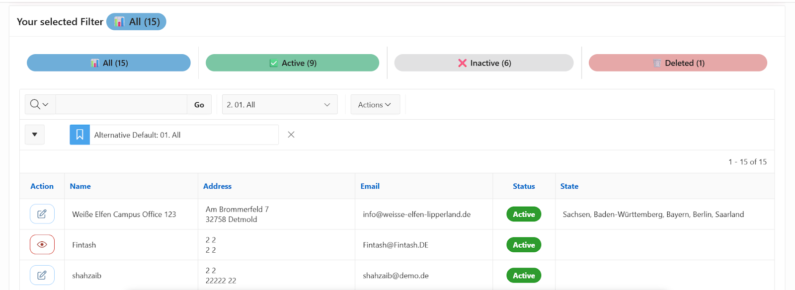
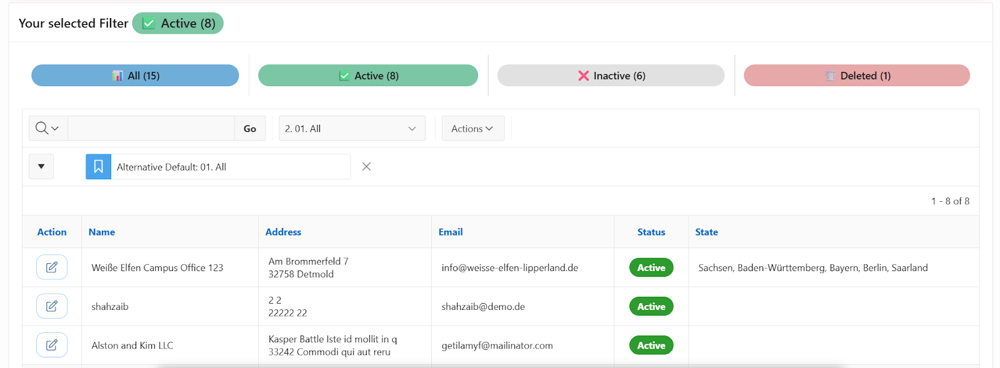
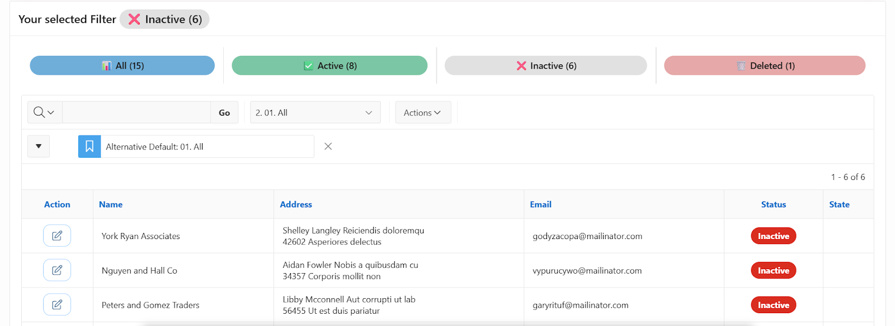
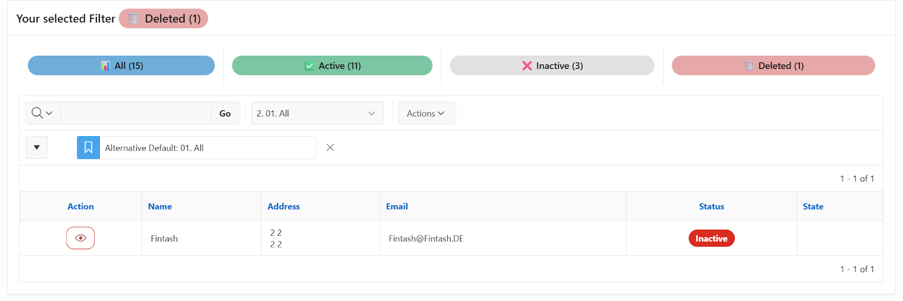

# Build Colorful Badge Status Filters in Oracle APEX — Fast Filter with Live Counts

[](LICENSE)


> Clickable status badges with live counts that filter a report, built from a Classic Report, a Badge List and a little CSS.

<p align="center">
  
</p>

**By Hassaan Ahmed Tahir — Senior Oracle APEX Developer · [Read the full tutorial](https://apexwithhassaan.vercel.app/blog/badge-status-filters)**

---

## 📁 Repository structure

```
apex-badge-status-filters/
src/selected_filter_region.html     # "Selected Filter" display region
src/fast_filter_region_query.sql    # "Fast Filter Option" classic report query
src/report_filter_condition.sql     # filter condition for the main report
src/before_header_set_filter.sql    # Before Header process that sets the selected filter
src/badge_filters.css               # badge styles
docs/images/                        # screenshots from the blog post
CHANGELOG.md
LICENSE                             # MIT
README.md
```

> 💡 Every file above contains the exact code from the tutorial below, ready to copy or run.

---

If you've ever wanted to give your reports those clean, colorful pill-shaped filters — like **All**, **Active**, **Inactive**, **Deleted** — each showing a live record count and instantly filtering the main report on click, this post is exactly that. No plugins, no JavaScript frameworks — just native APEX regions, a Badge List report, and a splash of CSS.

**The scenario:** An Employee Overview page shows a summary bar of clickable badges — *📊 All (3)*, *✅ Active (3)*, *❌ Inactive (0)*, *🗑️ Deleted (0)* — with the currently selected filter echoed back above the badges as a small colored chip. Clicking any badge instantly re-filters the underlying employee report.

> ✅ **End result:** A soft, rounded, color-coded filter bar that feels like a modern SaaS dashboard — built entirely with native APEX components.

## 📑 Table of Contents

1. [Create the Hidden Page Items](#step-1)
2. [Create the "Selected Filter" Display Region](#step-2)
3. [Create the "Fast Filter Option" Region (Classic Report)](#step-3)
4. [Turn the Report Into a Badge List](#step-4)
5. [Add the Filter Condition to the Main Employee Report](#step-5)
6. [Add a "Before Header" Process to Set the Selected Filter Chip](#step-6)
7. [Style the Badges with CSS](#step-7)
8. [Apply the CSS Class and Test It](#step-8)
9. [See It In Action](#in-action)
10. [Why This Approach Works So Well](#why-it-works)

<a id="step-1"></a>

## 1. Create the Hidden Page Items

We start with three hidden page items that will carry the state of the current filter and the styling of the selected-filter chip:

- `P20_SQL_FILTER_OPTION` — stores which filter is currently active (`ALL`, `ACTIVE`, `INACTIVE`, `DELETED`)
- `P20_SUM_STATUS_NAME` — stores the display label with live count (e.g. *✅ Active (3)*)
- `P20_SUM_STATUS_NAME_COLOR` — stores the hex color matching the currently selected filter

All three are plain **Hidden** items sitting in the page's Region Body — no special settings needed at this stage.

<a id="step-2"></a>

## 2. Create the "Selected Filter" Display Region

Next, we create a small static region that echoes back the currently selected filter as a colored chip, right above the badge bar:

```html
<font class="wess_current_filter">Your selected Filter</font>
<span class="custom_status_badge_small" style="background:&P20_SUM_STATUS_NAME_COLOR.;"> &P20_SUM_STATUS_NAME.</span>
```

Notice how the background color and the label text are both driven directly from our two hidden items using APEX substitution syntax (`&ITEM_NAME.`) — so this chip always reflects whichever filter is currently active.

<a id="step-3"></a>

## 3. Create the "Fast Filter Option" Region (Classic Report)

This is the heart of the feature — a Classic Report region named **Fast Filter option**, built on a query that returns one row per filter, each with its own label, filter code, sort order, and color:

```sql
-- =====================================================
-- EMPLOYEE KPI Overview (Soft Colors + Icons)
-- =====================================================

SELECT
    '📊 All (' || COUNT(*) || ')'        AS SUM_STATUS
  , 'ALL'                                AS SQL_FILTER_OPTION
  , 1                                    AS SORT_ORDER
  , '#6FAED9'                            AS COLOR
FROM EMPLOYEE
JOIN COMPANY ON COMP_ID = EMPL_COMP_FK

UNION ALL

SELECT
    '✅ Active (' || COUNT(*) || ')'     AS SUM_STATUS
  , 'ACTIVE'                             AS SQL_FILTER_OPTION
  , 2                                    AS SORT_ORDER
  , '#7BC6A4'                            AS COLOR
FROM EMPLOYEE
JOIN COMPANY ON COMP_ID = EMPL_COMP_FK
WHERE EMPL_ACTIVE_YN  = 'YES'
AND   EMPL_DELETED_YN = 'NO'

UNION ALL

SELECT
    '❌ Inactive (' || COUNT(*) || ')'   AS SUM_STATUS
  , 'INACTIVE'                           AS SQL_FILTER_OPTION
  , 3                                    AS SORT_ORDER
  , '#E1E1E2'                            AS COLOR
FROM EMPLOYEE
JOIN COMPANY ON COMP_ID = EMPL_COMP_FK
WHERE EMPL_ACTIVE_YN  = 'NO'
AND   EMPL_DELETED_YN = 'NO'

UNION ALL

SELECT
    '🗑️ Deleted (' || COUNT(*) || ')'    AS SUM_STATUS
  , 'DELETED'                            AS SQL_FILTER_OPTION
  , 4                                    AS SORT_ORDER
  , '#E6A8A8'                            AS COLOR
FROM EMPLOYEE
JOIN COMPANY ON COMP_ID = EMPL_COMP_FK
WHERE EMPL_DELETED_YN = 'YES'

ORDER BY SORT_ORDER ASC
```

Each row represents one badge, complete with its own icon, live count, and pastel color — no hardcoded HTML, everything comes straight from the query.

### Column Setup

- **SUM_STATUS** — set as a **Link** that targets the same page (Page 20), passing `P20_SQL_FILTER_OPTION` = `#SQL_FILTER_OPTION#`
- **SQL_FILTER_OPTION**, **SORT_ORDER**, **COLOR** — all set to **Hidden** columns (they only drive logic and styling, never displayed directly)

```text
📁 Region Tree
  ▾ Hidden
    ▾ Region Body
      • P20_SQL_FILTER_OPTION
      • P20_SUM_STATUS_NAME
      • P20_SUM_STATUS_NAME_COLOR
  ▾ <font class="wess_current_filter">Your selected...
    ▾ Sub Regions
      ▾ 🔶 Fast Filter option
        ▾ Columns
          🔗 SUM_STATUS
          🚫 SQL_FILTER_OPTION
          🚫 SORT_ORDER
          🚫 COLOR
```

<a id="step-4"></a>

## 4. Turn the Report Into a Badge List

With the query and columns in place, go to the region's **Attributes** tab and change the report type to **Badge List**. Then configure it as follows:

- **Layout** → Grid
- **Appearance** → Apply Theme Colors
- **Wrapping** → Flexible Box

This instantly turns each report row into a rounded, theme-aware badge — no manual HTML markup required.

<a id="step-5"></a>

## 5. Add the Filter Condition to the Main Employee Report

Now the main Employee report needs a `WHERE` clause that reacts to whichever badge was clicked, using the hidden item `P20_SQL_FILTER_OPTION`:

```sql
-----------------------------------------------------------------------------
-- Dynamic Filter Options
-----------------------------------------------------------------------------
WHERE (
       :P20_SQL_FILTER_OPTION = 'ALL'

    OR ( :P20_SQL_FILTER_OPTION = 'ACTIVE'
         AND EMPL_ACTIVE_YN = 'YES'
       )

    OR ( :P20_SQL_FILTER_OPTION = 'INACTIVE'
         AND EMPL_ACTIVE_YN = 'NO'
        AND EMPL_DELETED_YN = 'NO'
       )

    OR ( :P20_SQL_FILTER_OPTION = 'DELETED'
         AND EMPL_DELETED_YN = 'YES'
       )
   )
ORDER BY EMPL_CREATED DESC;
```

Each click on a badge sets `P20_SQL_FILTER_OPTION` and refreshes this report, instantly narrowing the results.

<a id="step-6"></a>

## 6. Add a "Before Header" Process to Set the Selected Filter Chip

To keep the little colored chip from Step 2 always in sync with the current filter (including its live count), we add a **Before Header** page process called **"Set Selected Filter Badge"**:

```sql
-- =====================================================
-- PAGE 20 | Get Selected Filter Display Data
-- Process  : Before Header
-- Purpose  : Sets current filter chip label and color
-- =====================================================
BEGIN

    IF :P20_SQL_FILTER_OPTION = 'ALL' THEN

        SELECT
            '📊 All (' || COUNT(*) || ')'
          , '#6FAED9'
        INTO
            :P20_SUM_STATUS_NAME
          , :P20_SUM_STATUS_NAME_COLOR
        FROM EMPLOYEE;

    ELSIF :P20_SQL_FILTER_OPTION = 'ACTIVE' THEN

        SELECT
            '✅ Active (' || COUNT(*) || ')'
          , '#7BC6A4'
        INTO
            :P20_SUM_STATUS_NAME
          , :P20_SUM_STATUS_NAME_COLOR
        FROM EMPLOYEE
        WHERE EMPL_ACTIVE_YN  = 'YES'
        AND   EMPL_DELETED_YN = 'NO';

    ELSIF :P20_SQL_FILTER_OPTION = 'INACTIVE' THEN

        SELECT
            '❌ Inactive (' || COUNT(*) || ')'
          , '#E1E1E2'
        INTO
            :P20_SUM_STATUS_NAME
          , :P20_SUM_STATUS_NAME_COLOR
        FROM EMPLOYEE
        WHERE EMPL_ACTIVE_YN  = 'NO'
        AND   EMPL_DELETED_YN = 'NO';

    ELSIF :P20_SQL_FILTER_OPTION = 'DELETED' THEN

        SELECT
            '🗑️ Deleted (' || COUNT(*) || ')'
          , '#E6A8A8'
        INTO
            :P20_SUM_STATUS_NAME
          , :P20_SUM_STATUS_NAME_COLOR
        FROM EMPLOYEE
        WHERE EMPL_DELETED_YN = 'YES';

    ELSE
        -- Safety fallback
        :P20_SUM_STATUS_NAME       := '—';
        :P20_SUM_STATUS_NAME_COLOR := '#9CA3AF';
    END IF;

END;
```

> 💡 **Tip:** The `ELSE` branch is a safety net — if the hidden item is ever empty or holds an unexpected value, the chip falls back to a neutral gray dash instead of breaking the page.

<a id="step-7"></a>

## 7. Style the Badges with CSS

Finally, add the following CSS — either inline on the page or in a global static file — to give the badges their soft, pill-shaped, animated look:

```css
/* =====================================================
   FILTER BADGE BUTTON – Scoped Styling
   Scope: .filter_badge_button ONLY
   Page: Health Insurance Overview
   ===================================================== */

/* 🔧 Compact layout: remove spacing noise */
.filter_badge_button .t-BadgeList-wrap {
    padding: 0 !important;
    margin: 0 !important;
}

/* Remove theme background & shadow */
.filter_badge_button .t-BadgeList-wrap.u-color {
    background: transparent !important;
    box-shadow: none !important;
}

/* -----------------------------------------------------
   Hover & focus behavior
   ----------------------------------------------------- */
.filter_badge_button .t-BadgeList-item a:hover .custom-status-badge {
    transform: translateY(-1px);
    filter: brightness(1.05);
    box-shadow: 0 4px 10px rgba(0, 0, 0, 0.12);
    cursor: pointer;
}

.filter_badge_button .t-BadgeList-item a:focus-visible .custom-status-badge {
    outline: 2px solid rgba(0, 0, 0, 0.35);
    outline-offset: 2px;
}

/* -----------------------------------------------------
   Entry animation
   ----------------------------------------------------- */
.filter_badge_button .t-BadgeList-item {
    animation: badgeFadeIn 0.2s ease-out both;
}

@keyframes badgeFadeIn {
    from {
        opacity: 0;
        transform: translateY(4px);
    }
    to {
        opacity: 1;
        transform: translateY(0);
    }
}

/* -----------------------------------------------------
   Stretch badges to full clickable area
   ----------------------------------------------------- */
.filter_badge_button .t-BadgeList-item {
    display: flex !important;
    align-items: stretch !important;
}

.filter_badge_button .t-BadgeList-wrap,
.filter_badge_button .t-BadgeList-value,
.filter_badge_button .t-BadgeList-item a {
    display: flex !important;
    align-items: stretch !important;
    height: 100% !important;
}

.filter_badge_button .t-BadgeList-item a {
    width: 100% !important;
    text-decoration: none !important;
}

/* -----------------------------------------------------
   Badge chip styling (core)
   ----------------------------------------------------- */
.filter_badge_button .custom-status-badge {
    display: flex !important;
    align-items: center !important;
    justify-content: center !important;

    width: 100% !important;
    height: 100% !important;

    padding: 4px 14px !important;
    border-radius: 999px;

    font-size: 13px;
    font-weight: 500;
    color: #1f1f1f;

    white-space: nowrap;
    transition: all 0.15s ease-in-out;
}

/* -----------------------------------------------------
   Mobile optimization
   ----------------------------------------------------- */
@media (max-width: 768px) {
    #filter_badge_button .custom-status-badge {
        font-size: 12px;
        padding: 5px 10px;
    }
}

/* -----------------------------------------------------
   Mobile optimization - in region new line for selected filter
   ----------------------------------------------------- */
@media (max-width: 768px) {
    .wess_current_filter {
        display: block;
        margin-top: 6px;
    }
}

/* =====================================================
   Global / UI Utility
   Purpose: Small status badge with soft pill styling
   Usage: KPI, status, and filter indicators
   ===================================================== */
.custom_status_badge_small {
    padding-left: 10px;
    padding-right: 10px;
    padding-top: 2px;
    padding-bottom: 4px;
    border-radius: 20px;
}
```

<a id="step-8"></a>

## 8. Apply the CSS Class and Test It

Last step: open the Fast Filter region's **Appearance** section and add `filter_badge_button` as the region's **CSS Classes**. Save, run the page — and your colorful, animated, live-count filter bar is ready to go.

> ✅ **Result:** Clicking any badge instantly re-filters the Employee report, updates the "Your selected Filter" chip with the matching color and live count, and the whole bar gracefully collapses to a clean stacked layout on mobile.

<a id="in-action"></a>

## 📸 See It In Action

Here's the finished filter bar in a real app, cycling through all four states — notice how the "Your selected Filter" chip above the badges always matches whichever one was just clicked, live count and all:

<p align="center">
  <br>
  <em>📊 All — every employee, blue chip and badge in sync</em>
</p>

<p align="center">
  <br>
  <em>✅ Active — filtered down, green chip reflects the live count</em>
</p>

<p align="center">
  <br>
  <em>❌ Inactive — empty state, gray chip matches the badge</em>
</p>

<p align="center">
  <br>
  <em>🗑️ Deleted — red chip, consistent right down to the last state</em>
</p>

<a id="why-it-works"></a>

## Why This Approach Works So Well

- **Fully data-driven** — colors, labels, and counts all come from SQL, not hardcoded HTML
- **Zero JavaScript required** — built entirely on the native APEX Badge List report type
- **Consistent state** — the Before Header process keeps the selected-filter chip perfectly in sync with whatever was clicked
- **Mobile-friendly** — the CSS includes responsive rules so the filter bar and chip adapt gracefully on small screens
- **Easy to extend** — adding a new filter status is just one more `UNION ALL` branch and one more `ELSIF`

That wraps up this feature — a fully native, colorful, animated badge filter bar for Oracle APEX reports. If you build this into your own app, let me know how it turns out!

---

## 📝 Changelog

See [CHANGELOG.md](CHANGELOG.md) for the version history.

---

## 📄 License

Released under the [MIT License](LICENSE) — free to use, modify and redistribute in personal and commercial projects.

---

## 🙏 Credits

Built by **Hassaan Ahmed Tahir** — Senior Oracle APEX Developer.
Special thanks to **Sajjad Hanifa** for his continued guidance and support in exploring and refining these Oracle APEX techniques.

📌 Read the original write-up on **[APEX with Hassaan](https://apexwithhassaan.vercel.app/blog/badge-status-filters)**, and keep an eye on the blog for more Oracle APEX tutorials.
